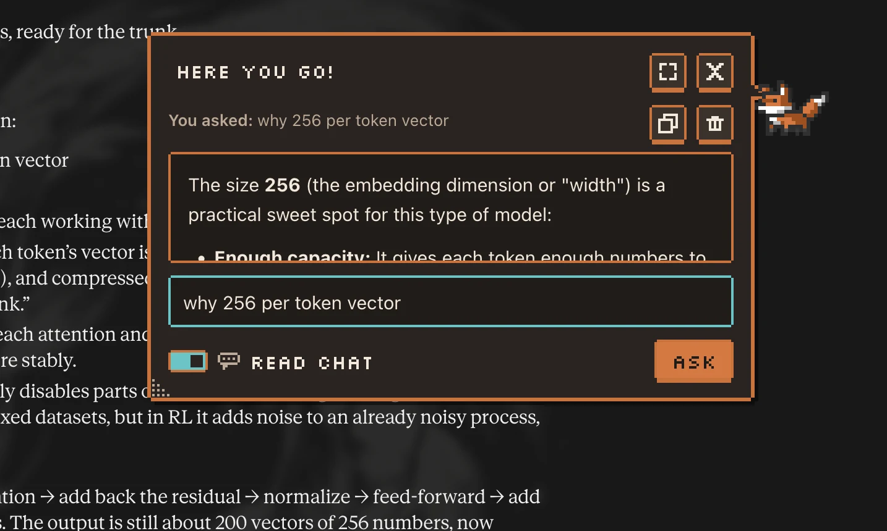

# Renard

## Introduction

<!-- Introduction: to be written by the owner -->

## What it does



Renard is a pixel-art fox that lives in the side margins of the browser
window on claude.ai and chatgpt.com (and on any other website you add),
wandering around a little while it waits.
Click it, ask a question, and the answer comes from your own Anthropic, OpenAI,
or Gemini API key, or from a built-in Gemma model that runs on your own
computer, streamed into a large, readable panel. With **Read chat** on, the
conversation open on the page is sent along as context, so questions like
"summarize this chat" work. On other websites the switch reads **Read page**
and sends the page's text instead.

The fox's personality is scripted: canned lines (`src/lines.json`) and sprite
animations. The AI is only the answer engine and has no persona.

Renard runs in Firefox (its primary browser) and Chrome. It is not on the
add-on stores yet; load it from source as described below.

## Setup

Requirements: Node.js 20 or later, Firefox 140 or later (primary), or a
Chromium-based browser.

```sh
npm install
```

`npm install` also copies the built-in model's engine (Transformers.js and
ONNX Runtime Web, about 28 MB) into `src/vendor/` (git-ignored). The
extension needs none of the dependencies' own install scripts, so
`npm ci --ignore-scripts && npm run vendor` works too.

### Sprite sheet

Renard uses "2D Pixel Art Fox Sprites" by Elthen. The license does not allow
redistributing the art, so it is not in this repository. Get the pack from
Elthen's itch.io page and save the sheet as:

```
src/assets/fox-sprite-sheet.png
```

The sheet is 448×224 px: 32×32 frames in a 14-column × 7-row grid, fox facing
right. Without it, Renard still works and shows a static placeholder fox.

The toolbar icon is a separate, original fox head drawn for Renard (in
`scripts/make-icons.mjs`), so it is committed and does not depend on the sheet.
Run `npm run icons` after editing that art.

### Run in Firefox

```sh
npm start
```

This launches Firefox with Renard loaded through `web-ext`, reloading on file
changes. To load it into your own Firefox profile instead, open
`about:debugging#/runtime/this-firefox`, choose **Load Temporary Add-on**, and
pick `src/manifest.json` (removed when Firefox restarts).

Firefox treats host access as optional for Manifest V3 extensions. If the
toolbar icon shows a **!** badge, open Renard's settings and use **Allow
access** for each site and for the API.

### Run in Chrome

`src/manifest.json` is written for Firefox, so Chrome loads a generated build:

```sh
npm run build:chrome
```

Then open `chrome://extensions`, turn on **Developer mode**, choose **Load
unpacked**, and select `dist/chrome/`. Rerun `npm run build:chrome` (and click
reload) after changing files. `npm run start:chrome` builds it and opens a
fresh Chrome profile with Renard loaded.

### First run

The settings page opens on install (it is also in the toolbar menu). Choose a
provider, paste an API key, and pick a model; loading the model list doubles as
the key check. Or choose **Built-in** and download a Gemma model to run without
a key (see below).

## Built-in model

Choosing **Built-in** in settings runs Gemma on the computer's graphics chip
through WebGPU, with no API key. The model downloads once from Hugging Face,
is kept in the browser's extension storage, and works offline after that;
settings shows the space used and can delete it.

| Model | Download (Chrome / Firefox) | Notes |
| --- | --- | --- |
| Gemma 3 1B (default) | 0.8 / 0.9 GB | Quick and light; short questions and summaries |
| Gemma 4 E2B | 3.1 / 3.6 GB | Noticeably smarter; needs about 5 GB of free memory |

It needs WebGPU: Chrome 113 or later, or Firefox 147 or later on Apple Silicon
Macs and Windows (not yet Intel Macs or Linux). Firefox uses the `q4` builds,
because its WebGPU rejects a shader in the `q4f16` builds that Chrome uses. In
testing on an Apple Silicon Mac, Gemma 3 1B started answering in about half a
second and wrote about 8 tokens per second in Firefox; Chrome is faster. Read
chat sends a shorter part of the conversation to the built-in model.

## Using Renard

| Action | Result |
| --- | --- |
| Click the fox | Opens the bubble with a text box |
| Enter / Shift+Enter | Ask / new line |
| **Read chat** switch | Include the conversation on the page (**Read page** on other websites: the page's text) |
| Drag the fox | Drop it anywhere; it runs back into the nearest side margin (side and height remembered per site) |
| Esc or ✕ | Close the bubble |
| Expand button | Larger reading view |
| Drag any corner of the bubble | Resize it in both directions (size remembered) |
| Copy / Clear buttons | Copy the answer / clear the question and answer |
| Alt+Shift+F | Open or close the bubble |
| Alt+Shift+H | Hide or show Renard |

Clicking Renard's toolbar icon opens a small menu:

- **Show Renard** sends the fox home from every tab, or brings it back
  (on by default).
- **On this site** turns Renard on or off for the website in the current tab.
  For a new website, the browser asks for access to that one site; Renard
  then appears there right away and on later visits. Added sites are listed
  in settings under Sites, where they can be removed. Only secure (https)
  pages can be added.
- **Open settings** opens the settings page.

On macOS, Alt is Option. Shortcuts can be changed in Firefox under
`about:addons` → gear menu → **Manage Extension Shortcuts**, or in Chrome at
`chrome://extensions/shortcuts`; Renard picks up the new keys. They also work
while typing in Renard's bubble or the site's message box, where a focused text
field would otherwise take the key first.

## Privacy

- Questions go directly from the browser to the chosen provider. There is no
  Renard server.
- Chat content is read only when a question is sent with **Read chat** on, and
  is never stored. Long chats are trimmed to the most recent part, and Renard
  says when it did so.
- The site and the provider are independent: a ChatGPT conversation can be sent
  to Anthropic or Google, and a Claude conversation to OpenAI or Google.
- On the Gemini API's free tier, Google's terms allow it to use submitted
  content and responses to improve its products, and human reviewers may read
  them. Paid-tier requests are not used for product improvement (and in the EEA,
  Switzerland, and the UK the paid-tier terms apply to all use).
- API keys are kept in `storage.local` on the device, unencrypted, as is
  standard for bring-your-own-key extensions. Only the background script and the
  settings page read them; the script injected into the page never does.
- OpenAI requests set `store: false`. Gemini keys are sent in the
  `x-goog-api-key` header, never in request URLs.
- With the built-in model, questions and chats never leave the computer. The
  only network traffic is the one-time model download from Hugging Face,
  pinned to a fixed commit of each model's repository.
- On a website you add, Renard sends the page's visible text, title, and
  address without its query string or fragment, and only with **Read page**
  on.
- The bubble's contents (question, answer, text box) live in an extension
  frame that the site's scripts can't read or script, so the site can't see
  what is typed into Renard or what it answers. The API key is never on the
  page.

## How it works

```
src/
  manifest.json          MV3, written for Firefox; the Chrome build swaps in a service worker
  background/            API calls, settings, asset delivery, badge, shortcuts
  shared/                constants, settings access, provider clients, prompt
  engine/                built-in model (Transformers.js on WebGPU)
  content/               on-page UI: the fox and the bubble's outline (closed Shadow DOM)
  bubble/                the bubble's contents, in an extension frame
    adapters/            per-site chat reading, composer location, theme; web.js reads any other page
  popup/                 toolbar menu (show Renard, this site, settings)
  options/               settings page
  lines.json             canned fox lines
  fonts/                 Silkscreen (SIL Open Font License)
  icons/                 toolbar icons (original fox head, from scripts/make-icons.mjs)
  vendor/                Transformers.js and ONNX Runtime Web (copied on npm install)
scripts/                 icon generator, engine vendoring, store packaging
test/                    unit tests (node --test)
```

- **Content script** builds the fox and the bubble's outline inside a closed
  Shadow DOM, so site styles and Renard's styles never mix. It loads the
  sprite, fonts, and stylesheet as bytes from the background script and draws
  the sprite on a canvas, so the host page's Content Security Policy is never
  involved.
- **Bubble frame** (`bubble/`) holds everything the user reads and types: an
  extension page in an iframe inside the bubble, which the site can neither
  read nor script (and which isn't listed in the page's `window.frames`).
  The content script drives it over a `MessageChannel` handed to the frame
  with a one-time key; the key travels through the background script, which
  sites can't reach, so a site that got hold of the frame couldn't open a
  channel of its own. Keys typed in the frame never reach the site, so the
  frame handles Esc and Renard's shortcuts itself.
- **Site adapters** (`content/adapters/`) are the only site-specific code: how to
  read user and assistant turns, where the message input is (so the bubble
  avoids covering it), and the page theme. When an adapter can't find messages
  on a chat page, Renard says so and answers without the chat. `web.js`
  handles every other site by reading the largest main or article region.
- **Added websites** use optional host access, requested for one site at a
  time from the toolbar menu. The background script registers the same
  content scripts for those sites (`scripting.registerContentScripts`),
  rebuilds that registration at startup, and injects them into tabs already
  open. Styles go in through a constructed stylesheet where the browser
  allows it, so a page whose security policy forbids inline styles still
  shows Renard correctly.
- **Background script** owns the API keys. Each question opens a port; the
  answer streams back over it, and closing the port cancels the request.
- **Built-in engine** (`engine/`) runs Transformers.js on WebGPU. Firefox's
  background page hosts it directly; Chrome's service worker can't, so it runs
  in an offscreen document reached over a port. The page and settings ping the
  background during answers and downloads, because Firefox suspends an idle
  background page after about 30 seconds. The engine's code ships in the
  package (no code is loaded from the network); only model weights are
  downloaded.
- **Providers** (`shared/providers.js`) call the APIs with `fetch` and parse
  the SSE streams: the Anthropic Messages API (`anthropic-version: 2026-10-21`),
  the OpenAI Responses API, and the Gemini API's `streamGenerateContent`
  (`alt=sse`). Optional request fields (low effort, refusal fallbacks,
  reasoning effort, Gemini thinking level) are sent when the model supports
  them, with one automatic retry without them if a model rejects them.

## Development

```sh
npm test         # unit tests: markdown, SSE parsing, providers, prompt, paths, shortcuts
npm run lint     # web-ext lint (Mozilla's add-on linter)
npm run icons    # regenerate src/icons/ from the fox head art
npm run build    # store zips: dist/renard-firefox-<version>.zip, dist/renard-chrome-<version>.zip
```

Release steps for addons.mozilla.org and the Chrome Web Store are in
[`docs/publishing.md`](docs/publishing.md); the privacy policy is
[`PRIVACY.md`](PRIVACY.md).

For a permanent Firefox install, sign the build as an unlisted add-on on
addons.mozilla.org (free, automated, not public), or use Firefox Developer
Edition with `xpinstall.signatures.required` set to `false`.

The Firefox add-on ID is `renard-companion@YeziShanYang` and should not change.

## Credits

- Fox art by Elthen ("2D Pixel Art Fox Sprites").
- Silkscreen font by The Silkscreen Project Authors, SIL Open Font License
  (`src/fonts/OFL.txt`).
- Built-in model engine: Transformers.js by Hugging Face (Apache 2.0) and ONNX
  Runtime Web by Microsoft (MIT).
- Gemma models are by Google and are downloaded from Hugging Face under their
  own terms, listed on each model's page.
